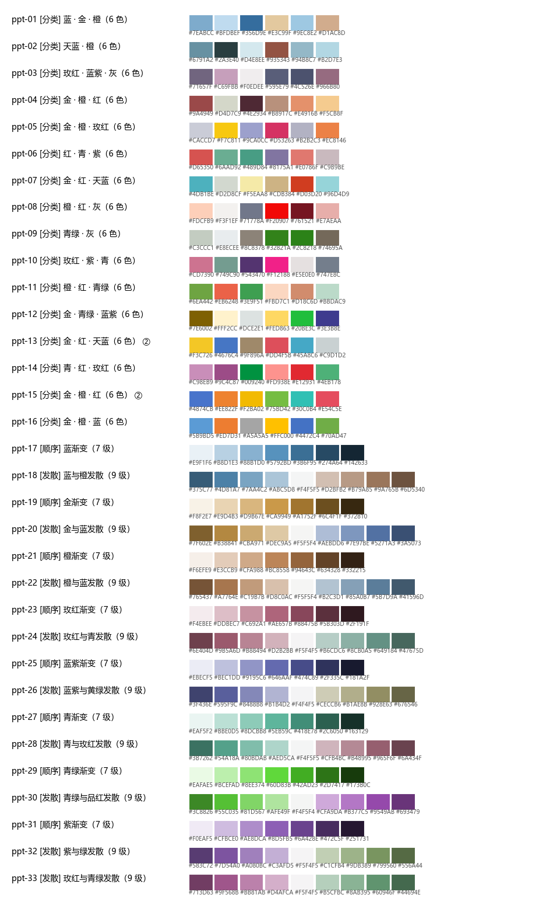

# SciFigure Studio · 科研制图工作台

**Interactive SCI figure workbench for DeepSeek Harness.** Draft a figure from your data in chat, then tune it live in a full-page workbench — map projections, graticules, colorbars, legends, fonts, axes, a 33-palette library — with the exact Python code for every figure available for download.

一个跑在 DeepSeek Harness 里的**交互式 SCI 单图制图插件**：对话里给数据和说明生成草图，然后从左侧任务栏进入整页工作台，实时调投影 / 经纬网 / 色带 / 图例 / 字体 / 坐标轴 / 配色；也可以用一句中文改图；每张图都有可独立运行的 Python 代码。

> 地图/研究区图、柱状/折线/散点/热力/箱线图；只做**单图**（不提供拼接/合成/图库）。



---

## ✨ 功能

| 能力 | 说明 |
|---|---|
| 🗺 地图 | cartopy 投影切换（11 种：等经纬 / 墨卡托 / 兰伯特 / 阿尔伯斯 / 罗宾逊 / 莫尔韦德 / 等地球 / 正射 / 北极立体 …）、中央经线与标准纬线、范围预设、经纬网（间距/度分格式/方位）、图层（国界/省界/海岸线/湖泊/河流/南海插图）、色带、比例尺、指北针、点/气泡/分级设色 |
| 📊 统计图 | 折线（多序列/双轴）、柱状（分组/堆叠）、散点（拟合线与方程）、热力图、箱线；坐标轴、图例自动避让、线型标记、数值标签 |
| 🎨 配色 | 33 套内置配色（分类 16 / 顺序 8 / 发散 9）；分类色用于折线/柱/散点，顺序色用于连续填色与色带，发散色用于正负 |
| 📐 期刊规范 | 7 种期刊预设（通用 SCI / Nature / Science / Elsevier / IEEE / 地理学报 / 遥感学报）、单栏 89mm / 双栏 180mm、字号 6–9pt、刻度朝内、色带小数位统一、数据来源脚注、子图编号 |
| 🧰 工具区 | 按图类自动识别（地图 / 统计图 / 通用），只显示相关参数；250ms 防抖实时重绘、撤销/重做 |
| 💬 一句话改图 | 「图例放右下角，字号调到 8」「换成墨卡托投影」「用第 3 套配色」——确定性解析成参数补丁 |
| 🧾 代码即产物 | 每张图对应一份可独立运行的 `component.py`（与引擎渲染逐字节一致），可复制/下载/再修改 |
| 🗂 会话 | 工作台可切换会话，调整历史对话里的图；删除工作区支持单图 / 单会话 / 全部（需 confirm） |
| 🤖 Agent 工具 | `scifig{draft|patch|nl|state|export|code|list|delete}`，模型可直接建图、调参、导出 |

## 📦 安装

**前置**：DeepSeek Harness（Web/桌面端）、Node ≥ 20、Python ≥ 3.10，Python 侧：

```bash
pip install matplotlib cartopy geopandas shapely pyproj pandas numpy pillow scipy adjustText
```

> cartopy 首次使用会下载 Natural Earth 底图（离线环境请预置 cartopy 数据目录）。中文出图需要系统里有宋体/黑体/微软雅黑任意一种。

**安装插件**（用 Harness 的 plugin manager 安装本地 bundle 目录）：

```
plugin_manager install_bundle  target = <本仓库目录>
```

或把本仓库放进 `~/.dsh/plugins/`，在 profile 的 `cordis.patch.yml` 里插入：

```yaml
- insert:
    - id: scifig-studio
      name: 'dsh-scifig-studio'
```

**配置 Python**（仓库不含任何机器路径），三选一：

1. 插件 config：`config: { python: '/path/to/python', workDir: '/path/to/figures' }`
2. 环境变量：`SCIFIG_PYTHON=/path/to/python`、`SCIFIG_WORKDIR=/path/to/figures`
3. 插件目录下创建 `.scifig-config.json`（已 gitignore）：

```json
{ "python": "C:\\venvs\\scifig\\Scripts\\python.exe" }
```

都没配时依次回退到 `<bundle>/.venv/…` 与 `PATH` 上的 `python`。

安装后左侧任务栏出现「科研制图」图标，Agent 侧多出 `scifig` 工具。**改 client.js 后刷新页面**；改 host 后停用→启用该插件。

## 🚀 用法

1. **对话里提需求**：

   > 用 `samples/map_points.csv` 画新疆土壤盐分空间分布图，点符号按盐分值分级，加经纬网、比例尺、指北针，色带单位 dS m⁻¹，Nature 风格双栏。

   Agent 调 `scifig{draft}` 生成草图，工具卡显示缩略图。
2. **进工作台**：左侧任务栏「科研制图」→ 整页工作台（预览 / 代码 两个页签）。
3. **工具区调参**：地图图显示投影 chips、经纬网、色带、比例尺…；统计图显示坐标轴、图例、线型…；改动实时重绘。
4. **一句话改图** / **导出 PNG** / **复制路径** / **查看代码**。

### 直接调用工具（Agent 侧）

```jsonc
{ "action": "draft", "dataFile": "samples/map_points.csv", "kind": "map",
  "description": "新疆土壤盐分空间分布，分级设色，经纬网 5 度，比例尺+指北针，Nature 双栏" }

{ "action": "patch", "set": { "map.projection": "mercator", "style.palette": "ppt-03",
                              "map.colorbar.palette": "ppt-17", "legend.position": "lower right" } }

{ "action": "nl", "text": "图例放右下角，字号调到 8" }
{ "action": "export" }        // 导出 PNG
{ "action": "code" }          // 取可独立运行的 Python 代码
{ "action": "delete", "mode": "figure" }   // mode=all 需 confirm:true
```

## 🧩 结构

```
index.js            Host 入口：注册工具 / HTTP 路由 / system prompt
client.js           浏览器端：左侧任务栏图标 + 整页工作台（预览 / 工具区 / 代码）
host/               Host 逻辑：api / ops / store / render / controls / infer / nl / spec / palettes …
py/scifig/          渲染引擎：engine / charts / spec / legend / controls.json / presets.json / palettes.json
py/tools/           引擎自检与资产生成器（controls.json、SPEC.md 由它们生成）
samples/            示例数据与 spec
docs/SPEC.md        参数全集（124 项）与已知限制
docs/CONTRACT.md    设计契约（Host / Client / Renderer 边界、API、工具 schema）
scripts/            verify-api.ps1（45 项接口验收）、extract_palettes.py（从 PPTX 重提配色）
```

产物目录（默认 `<bundle>/out`）：

```
out/<figureId>/{spec.json, figure.png, history/<rev>.json, meta.json}
components/<id>/component.py     # 可独立运行：python component.py --out x.png
```

## 🔌 HTTP API（同源，前缀 `/scifig`）

`health` `controls` `palettes` `state` `sessions` `patch` `nl` `preset` `image` `export` `download` `active` `code` `workspace/delete`

```bash
curl http://127.0.0.1:3080/scifig/api/health
curl -X POST http://127.0.0.1:3080/scifig/api/patch \
  -H 'content-type: application/json' \
  -d '{"figureId":"fig-...","set":{"map.projection":"robinson"}}'
```

> `compose` / `decompose` / `library` 等拼接类端点已移除，调用会返回「功能已移除」提示。

## 🎨 自定义配色

`py/scifig/palettes.json` 是配色数据源（`kind: categorical | sequential | diverging`）。可以从自己的 PPTX 重新提取：

```bash
python scripts/extract_palettes.py "my-deck.pptx" \
    --out py/scifig/palettes.json --preview out/palettes-preview.png
```

## ✅ 自检

```bash
npm run check:client              # node 语法
python -m compileall -q py/scifig # Python 语法
python py/tools/selftest.py --mode samples
powershell -ExecutionPolicy Bypass -File scripts/verify-api.ps1 -Origin http://127.0.0.1:3080
```

## 📄 License

MIT © 2026 wzgytuA888 — 详见 [LICENSE](LICENSE)。示例数据为合成数据。
